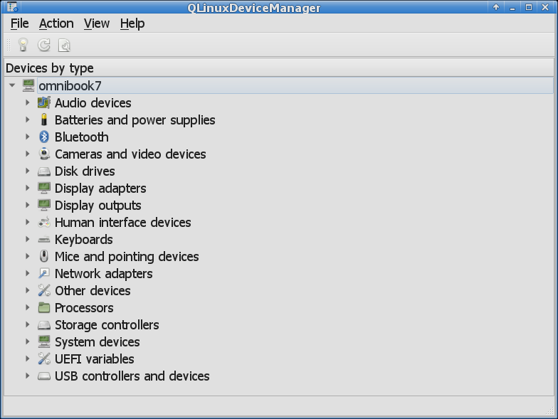
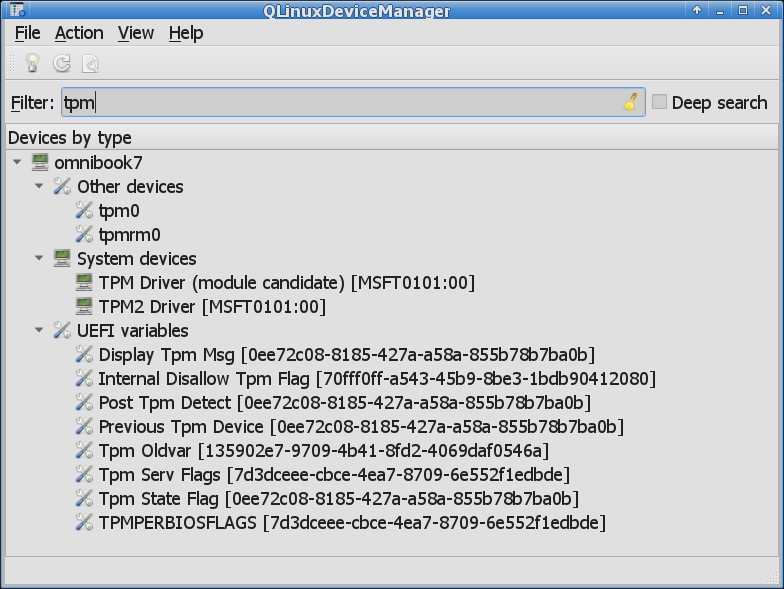
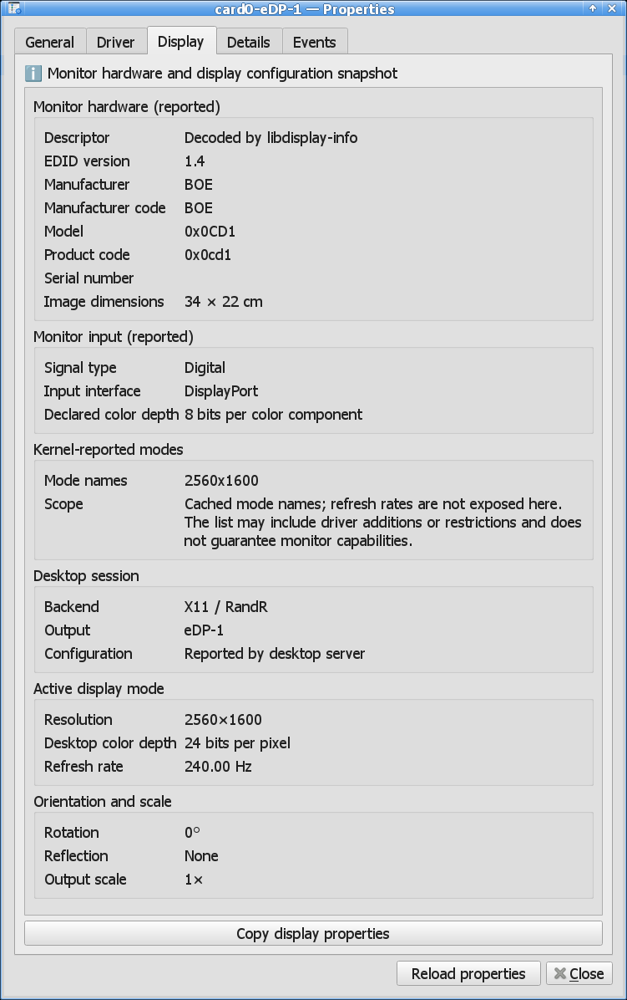

# QLinuxDeviceManager — Linux Device Manager

**QLinuxDeviceManager is a lightweight graphical Linux device manager and hardware
information viewer inspired by Windows Device Manager.** Browse your computer's
devices, inspect kernel drivers and hardware resources, examine storage volumes
and cached drive health, and watch live device events in one Qt desktop application.

It provides a Linux alternative to Windows Device Manager for hardware inspection
and troubleshooting. It runs as a normal user and reads local information through
libudev, sysfs and procfs, with optional UDisks2 storage metadata. No particular
desktop environment is required.

## Features

- **Hardware browser:** processors, PCI and USB devices, disk drives, storage
  controllers, network adapters, display adapters, audio devices, keyboards,
  pointing devices, Bluetooth, cameras, batteries and system devices.
- **Seven tree views:** inspect devices by type, connection or driver, and browse
  reported memory addresses, I/O ranges, IRQs and other hardware resources.
- **Device properties:** hardware identifiers, manufacturer, kernel paths, direct
  driver bindings, kernel module information and advanced udev/sysfs metadata.
- **Storage information:** SATA, NVMe and USB device metadata, related partitions,
  filesystems, mount points, encrypted/device-mapper layers, LVM and software RAID.
- **Cached drive health:** available ATA SMART failure predictions, temperatures
  and counts, plus NVMe critical warnings, through UDisks2.
- **System information:** CPU models and topology, cache totals, physical and usable
  RAM, motherboard and firmware details, operating system, kernel and uptime, secure
  boot status and MOK certificates.
- **Live hardware monitoring:** automatically update the inventory as devices are
  connected, removed or changed, with an Events tab for observed udev activity.
- **Search and copy:** filter device names or search advanced metadata and resources;
  copy property values, storage information, resource assignments and events.
- **UEFI variable viewer:** browse world-readable firmware variables and inspect
  their raw hex/ASCII contents.

The application is read-only. It does not install drivers, load or unload modules,
change driver bindings, rescan hardware buses, mount or unlock filesystems, modify
firmware variables, or power off devices. A device's presence or driver binding
alone does not establish that its hardware is healthy.

## Screenshots

**Main Window:**



**Main Window Search/Filter:**



**System Information**


**Device Properties**


**Monitor Information**



## Using the application

Launch `qlinuxdevicemanager` from a terminal or its desktop application entry.
The tree starts with your computer's hostname. Select a device and open
**Action → Properties**, use the toolbar or context menu, press **Enter** in the tree, or
double-click a leaf device. Double-clicking an item with children expands or
collapses its branch; Enter or **Properties** opens its properties.

| Action | How to use it |
| --- | --- |
| Refresh the device inventory | **F5** or **Action → Refresh** |
| Search device names | **Ctrl+F** or **View → Filter** |
| Search properties and resources | Enable **Deep search** in the search bar |
| Clear and hide the search bar | **Escape** or **Ctrl+F** |
| Reveal partitions and implementation records | **View → Show virtual and internal devices** |
| Open the system overview | **File → System Information** or Properties on the computer root |
| Reread a device's properties | **Reload properties** in its dialog |

Deep search collects metadata in the background. Its cache is refreshed after
inventory changes or an F5 refresh. Storage deep search uses native metadata;
it does not query UDisks2 for every device.

Virtual and internal devices are hidden by default to keep the hardware browser
readable. This includes UEFI variables, partitions, USB interfaces, input and sound endpoints,
DRM card/render nodes, disconnected and disabled display outputs, and many
transport or unbound kernel objects. Connected or enabled physical display
outputs remain visible by default; outputs with unknown/unreadable state also
remain visible. F5 rereads their kernel connection and enabled state, independently
of X11 or Wayland. Enabled means configured, not necessarily powered on. Visibility is
not a health or connectivity verdict. Friendly names retain kernel identifiers
where needed to distinguish identical devices; tooltips explain their sources.
Some related records are grouped in the default view and remain individually
accessible with internal devices shown.

USB-backed network interfaces use the nearest owning USB device's vendor and
product name, preferring local hwdb names and falling back to readable USB
manufacturer/product descriptors. Their interface identifiers remain in brackets.
Name sources identify that USB parent; raw interface properties are retained.
Missing device metadata does not cause a hub's or neighboring adapter's name to
be substituted, and genuine underscores in reported names are preserved.

Every launch starts in **Devices by type**, with **Show all devices** off and the
main toolbar visible. The computer root starts expanded so its categories are
visible; all subtrees start collapsed. View state is not saved on exit. Window
size and position persist, and expansion and selection are retained during
updates within the session.

## Hardware and driver views

Choose a view from the **View** menu. All views use the same device inventory.

| View | What it shows |
| --- | --- |
| Devices by type | Devices grouped by their hardware or functional category |
| Devices by connection | Devices arranged by their recorded kernel parent relationships |
| Devices by driver | Directly bound devices grouped by subsystem and driver |
| Drivers by device | Each device's direct driver and observed owning kernel module |
| Drivers by type | Device category, bus-qualified driver and associated devices |
| Resources by type | Reported assignments grouped by resource kind and device |
| Resources by connection | Assignments under their reporting devices in the connection tree |

Connection views retain necessary ancestors for context. A parent device's driver
or resource assignments are not presented as belonging to its child. Driver views
show relationships for discovered devices, rather than listing every installed or
loaded module. Missing bindings or module links are reported without assuming a
fault or a built-in driver.

Resources include directly associated PCI and Plug and Play memory/MMIO and I/O
ranges, PCI BARs and expansion ROM resources, IRQs, readable MSI/MSI-X vectors, and
reported PnP DMA channels and bus windows. Unsupported, disabled, unassigned and
restricted observations remain explicit. Shared interrupts or overlapping ranges
are not automatically labelled conflicts. The application reads resource metadata,
not PCI BAR contents.

## Device properties

The modeless Properties dialog provides these tabs when applicable:

| Tab | Information |
| --- | --- |
| General | Name, category, manufacturer, bus/subsystem, location, observed status and selected hardware identifiers |
| Driver | Direct driver binding, owning module, available running version and optional installed-module metadata |
| Network | IPv4/IPv6 addresses and masks, MAC addresses, MTU, and Ethernet link speed, duplex, autonegotiation and modes |
| Display | Reported monitor identity, dimensions and input capabilities, kernel mode names, plus desktop-session resolution, color depth, refresh rate, rotation/reflection and scale |
| PCIe | Current link speed/width, reported device maximum speed/width, and connection type when running as root |
| Battery | Reported capacities, estimated retention, cycle count, chemistry, voltage, percentage, status, current and power |
| USB | USB version, connection speed, active configuration, declared power/current, remote wakeup capability and interface functions/drivers |
| Details | Generic properties, source attribution, advanced raw metadata and copy controls |
| Resources | Directly reported hardware resource assignments and read/parse errors |
| Storage | Selected storage device identity, capacity, transport, sector sizes and flags |
| Volumes | Related storage layers, content, mount points, identifiers and backing relationships |
| Health | Each related drive's available cached ATA SMART or NVMe health evidence |
| Events | Live udev observations associated with the exact device instance |

Storage-specific information stays in its dedicated tabs, including when advanced
Details are enabled. Sources are available in tooltips or copied text. Compact
information captions expose scope and coverage notes when hovered.

Properties are collected on demand. F5 refreshes the inventory; **Reload properties**
updates the open device snapshot. A removed or replaced device leaves a marked,
read-only snapshot with reload disabled. Reconnecting a device at the same kernel
path does not intentionally retarget the old dialog to the replacement.

The **PCIe** tab uses scrollable, grouped label/value sections on PCI device
nodes exposing at least one PCIe link attribute (including unreadable attributes).
Ordinary PCI devices with none of these attributes and non-PCI children do not
get an empty tab or inherit a parent's link information. Current link speed/width
are separate from the device's reported maximum speed/width. Known rates from
2.5 through 128 GT/s are annotated as PCIe generations 1 through 7; unfamiliar
speed strings are preserved. Lane widths use `xN` notation. Unknown speed, a
reported zero width and the kernel's unknown maximum-width sentinel (`255`)
are unavailable, not a healthy/zero-speed link or a 255-lane capability. Other
widths exceeding the six-bit PCIe width field are malformed. Missing fields,
unsupported queries, permission failures and malformed values are shown explicitly.

These are kernel-reported link snapshots, not measured throughput. Device maxima
are separate capability declarations, not a guarantee about the slot or upstream
path, which is not assessed. Reduced current speed/width is not automatically a
fault: power management and topology can explain it. Four bounded sysfs link
reads run in the existing properties worker, with cancellation and device-instance
checks. The kernel may temporarily runtime-resume a device while servicing these
reads. **Reload properties** refreshes the snapshot; **Copy PCIe properties** keeps
section headings and field labels. Raw readings also remain in advanced Details.

When running as root (including through `sudo`), the same on-demand worker also
reads the selected device's PCIe connection type from its sysfs `config` file.
It follows at most 48 standard capability headers within the first 256 bytes,
reading only the necessary header fields and PCI Express flags; invalid offsets,
loops, truncated reads, permission failures and removal are handled explicitly.
It does not dump configuration space, scan extended capabilities, access BARs,
write settings, invoke subprocesses or poll in the background. Normal-user runs
skip configuration reads and show a note explaining that root access is needed
for the connection type; elevation does not guarantee all information is available.

A confirmed **Root Complex Integrated Endpoint** or **Root Complex Event Collector**
shows that conventional PCIe link speed and lane width are not applicable. Its
current/max-link sections and upstream interpretation are replaced with that
connection explanation. Other devices and failed type reads retain the link
sections. This is a generic PCIe topology classification, not an iGPU-ID database,
and it makes no claim about maximum operating performance. Raw sysfs link readings
remain available in advanced Details, including on integrated endpoints.

The **Battery** tab appears only on `power_supply` nodes identified as type
`Battery`, including peripheral batteries exposed by their drivers; it does not
appear on AC/USB chargers merely because they share the power-supply category.
Its grouped label/value sections show presence, charging status, charge percentage,
voltage, current and power, available energy/charge capacities, cycle count,
chemistry and identity metadata. All values belong to the selected supply.
Reads are bounded to the fixed attribute list in the properties worker, on demand
only; there are no subprocesses, polling, setting changes or battery tests.
**Reload properties** refreshes the snapshot and **Copy battery properties** keeps
section headings and field labels. Sources are available in field tooltips.

Energy is displayed in Wh and charge in mAh, in separate sections when reported.
Estimated capacity retention is `100 × full / design`, computed separately from
positive matching energy or charge measurements; values over 100% are preserved.
It is a firmware-based estimate, not a complete health verdict. No energy/charge
conversion, inferred charge percentage or calculated power is substituted for
missing readings. Current and power retain their reported signs. Cycle count
`0` means unavailable under the kernel ABI; zero full/design values cannot support
a retention estimate. Invalid numeric readings, unsupported queries and read
failures remain explicit. A reported absent battery has measurements marked not
applicable. Changed type/presence during collection invalidates the battery values;
a failed type refresh on a previously identified battery shows its read status.

The **Network** tab uses grouped, aligned label/value columns like System
Information, with Link and IP addresses sections for each interface. Each IP
address is shown as `address/network-mask`, using the literal IPv4 or IPv6 mask.
The tab also covers interfaces grouped under a PCI network adapter. Addresses
are from the application's network namespace, including IPv6 link-local addresses
with scope IDs. The hardware MAC
is the driver's permanent address; zero or missing driver results are unavailable.
An overridden MAC is the current address when it differs from the permanent
address, or Linux reports a random, inherited or explicitly set address. If neither
source establishes an override, its status remains unavailable. Non-Ethernet
interfaces show MAC fields as not applicable. Opening or reloading this tab only
reads configuration; it does not change addresses, MTU or interface state.

For Ethernet-style interfaces without kernel wireless markers, Network adds an
**Ethernet link** section with carrier state, operational speed, duplex,
autonegotiation, supported link modes/capabilities and link-partner advertised
modes. Wi-Fi shares Ethernet-style MAC framing but is excluded using its
`phy80211` and `wireless` sysfs markers; failed classification reads are shown
explicitly rather than treated as proof of Ethernet. Virtual Ethernet interfaces
may provide some fields or report the queries as unsupported; the section does
not establish a physical cable or port. Interfaces remain separately attributed
by their exact ifindex in the application's network namespace.

Collection uses native, read-only ethtool generic-netlink `LINKSTATE_GET` and
`LINKMODES_GET` requests, with a shared two-second reply-wait budget per interface
and cancellation checks at most every 50 ms during waits. Replies are limited to
64 KiB, mode bitsets to 4096 entries, and names to 127 bytes; malformed, oversized,
timed-out, unsupported and permission-denied replies remain explicit. No ethtool
executable, new library dependency, setting changes, cable tests, notification
subscriptions or background polling are added. These queries run only for explicit
Properties snapshots, not deep search. Kernel-provided mode names are preserved,
including capabilities such as pause or media type; unnamed bits retain their
index. Empty/missing partner advertisements stay unavailable. Carrier is checked
again after settings collection; detected changes or interface replacement discard
the Ethernet snapshot. A disconnected link has speed/duplex/partner modes marked
not applicable while supported capabilities and autonegotiation can remain visible.
Forced links do not claim a partner advertisement, and unknown speed never becomes
zero Mbps. Use **Reload properties** and the existing network copy button.

Installed module descriptions, filenames, licenses and versions require optional
libkmod support. Installed metadata can differ from code already loaded into the
kernel. Declared firmware filenames do not establish which firmware is loaded or
its version; directly reported firmware revisions are shown where available.

The **Display** tab is available on DRM output connectors and uses grouped
label/value sections like Network.
Monitor hardware appears above the active desktop configuration, using the exact
selected connector's cached `edid` and `modes` sysfs files. Optional
**libdisplay-info >= 0.1.1** decodes reported manufacturer/model, product code,
serial, image dimensions and digital input type/color depth. No EDID decoder is
bundled: without this library, decoding is explicitly unsupported while kernel
mode names and desktop settings remain available. Configure with
`-DDISPLAY_INFO=OFF` to disable it; CMake reports whether decoding is enabled.

Reads run only in the properties worker on demand, never force connector detection,
change settings or poll in the background. EDID is limited to 32 KiB and mode
text to 64 KiB / 2048 entries. Header, declared length and all block checksums
must pass before parsing. Unsupported EDID versions, corrupt framing, permission
failures and missing data remain distinct. Parser conformance warnings are shown
with decoded reports, rather than claiming that imperfect EDID is fully valid.
Connection status and EDID are reread to detect changes during collection; reload
if the report changed. Disconnected kernel connectors do not expose stale EDID.

Image dimensions are the reported image area, not enclosure dimensions; absent
or aspect-ratio-only measurements remain unavailable. Declared color depth is
separate from active desktop depth. EDID can be overridden or supplied by an
adapter/KVM, so identity and capabilities are reported claims. Kernel mode names
are deduplicated and may reflect driver additions/restrictions: they are not a
complete EDID timing catalog, do not distinguish refresh rates, and do not imply
that a mode is guaranteed to work. The existing display copy button includes
hardware headings and labels, and **Reload properties** refreshes both snapshots.
 Native X11/RandR and Wayland queries run in the
properties worker; `libxcb.so.1`, `libxcb-randr.so.0` and `libwayland-client.so.0`
are loaded on demand, without linking the application to either session API.
The selected Wayland session is queried directly even when the application runs
through XWayland; a failed Wayland query never falls back to emulated X11 outputs.
Queries do not change configuration, force detection or create a display surface.
Reply waits are cancellable and share a two-second budget per collection.

Resolution is the current physical mode before rotation/scaling. Refresh rate is
the nominal mode rate, not a measured or instantaneous variable-refresh rate.
X11 desktop color depth is the screen's root pixel depth, not panel/link depth;
Wayland output protocols do not expose it, so it remains unavailable. Output scale
is the X11 RandR transform (framebuffer pixels per output pixel, excluding desktop
DPI) or the Wayland rotated mode/logical-size ratio. The latter is marked derived
because logical dimensions may be rounded. Without logical-size information,
Wayland reports its integer buffer scale explicitly. Qt application scaling is
excluded; arbitrary X11 transforms are shown as custom instead of inventing a
single scale factor.

Session output names must match a unique kernel connector. The conventional
X11 `HDMI-N` / kernel `HDMI-A-N` naming difference is normalized. Ambiguous
multi-GPU names and unnamed/unmatched outputs remain unavailable rather than
borrowing another display's settings. Older Wayland compositors need xdg-output
v2 for names; otherwise wl_output v4 names are used. X11 queries cover the default
X screen. Missing libraries or protocol support leave the hardware view usable.
Disconnected session outputs show **Configuration: Disconnected**, based on a
fresh DRM status read or an explicit X11 output connection status. Connected
outputs without a mode retain **No active mode**. Zero rotation is shown as
**0°**; nonzero angles retain their counterclockwise direction.
Use **Reload properties** to refresh the monitor and desktop configuration snapshot.

The **Camera** tab appears on V4L2 image-capture nodes. Driver/card/bus
information uses grouped fields; a mode table keeps capture queue, pixel format,
resolution and frame intervals together. Single-plane and multi-plane capture
are kept separate. Metadata-only, radio/output and memory-to-memory codec nodes
are excluded after capability detection; if access fails, a video node retains
the tab to explain the permission, busy, removed or unsupported query state.
The tab describes capture-node capabilities, not necessarily a physical camera.

The properties worker invokes a private headless mode of the same executable,
using **libv4l2** to pass native `VIDIOC_QUERYCAP`, `VIDIOC_ENUM_FMT`,
`VIDIOC_ENUM_FRAMESIZES` and `VIDIOC_ENUM_FRAMEINTERVALS` queries to the driver.
The device is opened read-only/nonblocking. It is not registered for libv4l's
conversion/streaming setup, so converted formats are not added by the library.
No controls, formats, frame rates, buffers or streaming state are changed; no
frames are read. Opening a device can still wake hardware through its driver.

The helper is isolated because nonblocking opens do not give arbitrary driver
ioctls a timeout. The worker waits at most two seconds for its reply, checking
cancellation every 25 ms; it kills the helper on timeout/cancellation and never
blocks waiting for it to exit. A driver stuck in uninterruptible kernel sleep
may delay exit: only one unreaped helper is allowed, and later camera requests
retry reaping it rather than accumulating processes. This is on-demand collection,
with no background hardware polling. Queries are bounded to 4096 ioctls, 128
formats per queue, 128 sizes per format, 128 intervals per discrete size, 2048
mode rows and a 1 MiB reply. Limits and partial enumeration are explicit.

Each discrete size gets its own frame-interval query. Continuous/stepwise size
ranges remain ranges: frame intervals are marked size-dependent and are not
sampled or assigned to every size. Interval ranges retain their rational seconds
and interval step, rather than inventing a uniform frame-rate step. Discrete
rates are calculated as the reciprocal of the reported interval and retain the
exact rational interval. Missing/unsupported enumeration never becomes zero fps.
These are driver reports for the current media pipeline, not measured capture
rates or guarantees of simultaneous-stream throughput. Device-node major/minor,
connector directory identity and `/sys/dev/char` ownership are checked before
and after querying; a replaced/removed node discards the report. **Reload properties**
and **Copy camera properties** use the same owned snapshot, including headings
and labels for every mode. Capability queries are excluded from deep search.

The **USB** tab appears only on USB device nodes (including hubs), with grouped
label/value sections and a copy button. Its first **Connection** section shows the
reported USB specification version and kernel-reported connection speed in Mbps
or Gbps, using the same snapshot as the raw Details fields. Version is the device
descriptor's specification version, not the port's maximum capability; speed is a
link rate, not measured throughput (for root hubs it describes the USB bus).
It also adds active/available configurations, configuration description, interface
count, declared power source and maximum
current, remote wakeup capability, and each direct USB interface's function codes,
alternate setting, description and bound driver. Values are read in the properties
worker from sysfs; no control transfers or configuration changes are performed.
Power/current declarations are not live measurements, and remote wakeup capability
does not mean wakeup is enabled. Voltage is not inferred. Identity, revision and
bus/address metadata remain on **Details**. USB version and speed remain there
as raw values too; enable **Show advanced properties** to see raw sysfs values.
Interface snapshots are bounded to 256 direct children; read failures and changes
during collection are reported explicitly. Use **Reload properties** to refresh.

## Storage devices, volumes and health

Block devices and NVMe controllers have separate **Storage**, **Volumes** and
**Health** tabs. Available information includes model, manufacturer, serial number,
firmware revision, transport, capacity, logical/physical sector sizes, read-only
and removable-media flags, partition tables and filesystem identifiers.

Volumes retain explicit partition, backing and using relationships. Encrypted
mappings, LVM and RAID can span several devices; capacities are not added across
layers. Exact kernel/UDisks2 block mappings share one volume row, with conflicting
metadata shown explicitly. Missing or failed reads remain visible.

Mount points come from `/proc/self/mountinfo` and describe the application's
**mount namespace**. They include filesystem type and mount root, so bind mounts
and subvolume mounts can be distinguished. No observed mount is not proof that a
volume is unused elsewhere. No filesystem probing, mounting or unlocking occurs.

Optional UDisks2 support supplements native metadata when the service is already
running and accessible. Missing services, denied access and builds without QtDBus
retain native storage viewing. The UDisks2 removable-drive hint is distinct from
the kernel's removable-media flag.

Health information is **cached evidence**, with the last update timestamp where
available. ATA failure prediction, NVMe critical warnings, cached temperature and
available ATA bad-sector/failing-attribute counts are shown separately. Missing
interfaces or never-updated caches are unavailable; an absence of reported warnings
is not a guarantee of health. Opening or reloading Properties never requests SMART
updates, background polling or self-tests. UDisks2 may update its own cache
independently.

## System information

The system overview shows hostname, operating system, kernel architecture/release/
build, CPU models, sockets and cores, present and online logical processors, unique
cache totals by level/type, uptime, motherboard identity, firmware version/date,
boot-mode evidence and reported hypervisor identity.

**Physical RAM** uses available firmware-reported capacities from udev metadata.
**Usable RAM** uses Linux `MemTotal`; it is not currently free memory. When both
values are valid, their difference is shown as system-reserved RAM, covering all
memory unavailable to Linux rather than only firmware reservations. Missing
capacity is left unavailable instead of guessed.

CPU topology and virtualization information reflect what the running environment
exposes. A container or virtual machine may report a restricted or virtual system
view; absent virtualization evidence does not prove physical hardware. CPU cache
totals cover online processors. The overview collects no machine ID or system
serial number and does not launch external diagnostic programs.

Use **Refresh** to collect a new system snapshot and **Copy all** to copy its values.

## Live device events

The **Events** tab records udev observations received since the application started,
with receipt times, event types, descriptions and available payload details.
It retains at most **1,024 events globally** and displays the latest **256 events
per exact device instance**, newest first. Copy controls include the full coverage
notice.

This is session history, not a persistent Windows-style device log. Historical
journal and kernel messages are not queried. Related devices have separate
histories; UEFI variables have no udev value-change history. Uncertain event
associations are withheld, and detected monitoring failures or losses are reported.
No retained events does not establish that the device has had no errors.

Live device changes update the inventory automatically, with periodic reconciliation
and manual F5 refresh available. If monitoring fails, the application reports it
and retries. Kernel observations remain snapshots: undetected event loss and
reused paths without distinguishing metadata can limit instance tracking.

## UEFI firmware variables

On UEFI systems exposing `/sys/firmware/efi/efivars`, the **UEFI variables** category
lists regular files with the world-read permission bit set. This permission filter
also applies when running as root. Missing or inaccessible efivarfs does not
prevent ordinary hardware discovery.

The category and its subtree are hidden by default. Enable **View → Show virtual
and internal devices** to reveal them; disabling it hides the subtree again.

Names are separated into readable words; original names remain in tooltips.
Namespace GUIDs and full filenames are shown with internal devices enabled.
Equal names in different namespaces remain separate records.

Opening Properties reads up to **64 KiB** of the variable file as a hex/ASCII dump,
including its attribute prefix. Longer values receive a truncation notice.
Contents are not decoded or modified, and actual access can still be denied by
security policy despite the file's permission bits.

System Information also shows firmware Secure Boot status and exposed runtime MOK
certificates (owner, issuer and expiration in UTC). This is certificate metadata,
not a check of the running kernel's signer or certificate trust. Reading MOK data
may require permissions; unavailable data is shown explicitly. The kernel's MOK
table is preferred, with efivarfs as a fallback. Oversized or split fallback lists
are reported as errors rather than displaying a partial list. Qt's TLS backend
must be installed to decode X.509 certificates.

## Linux AppImage

The [Linux AppImage workflow](https://github.com/birdie-github/QLinuxDeviceManager/actions/workflows/ci.yml)
packages an x86_64 AppImage on pushes, pull requests and manual runs. Download the
artifact from a successful run and extract the ZIP, then launch it:

```sh
chmod +x QLinuxDeviceManager-*.AppImage
./QLinuxDeviceManager-*.AppImage
```

The package includes Qt 6.8, X11/Wayland platform plugins, application icons and
translations, and enables libkmod, QtDBus and libdisplay-info monitor decoding. It is built on Ubuntu 24.04;
older distributions are not guaranteed to be compatible. The host still provides
the Linux kernel, device metadata and optional UDisks2 service.

If FUSE is unavailable, launch with `--appimage-extract-and-run`. Workflow artifacts
are retained for 14 days; they are not automatically published as release assets.

## Build and installation

Requirements:

- Linux and a C++17 compiler.
- CMake **3.19 or newer** and pkg-config.
- Qt **6.8 or newer**, including Widgets and Network, and libudev development headers.
  Qt Network is used locally to decode MOK certificates; this feature makes no network requests.
- libv4l2 development headers/library (Fedora: **libv4l-devel**; Debian/Ubuntu: **libv4l-dev**).
- XCB RandR and Wayland client **1.20 or newer** development headers (runtime
  libraries are required only for the corresponding Display backend).
- Optional QtDBus **6.8 or newer** for cached UDisks2 storage metadata.
- Optional libkmod **30 or newer** for installed-module metadata and fallback names.
- Optional libdisplay-info **0.1.1 or newer** for monitor EDID decoding.
- Optional Qt Linguist tools **6.8 or newer** to build translation catalogs.

Fedora packages:

```sh
# Optional monitor EDID decoding: libdisplay-info-devel
sudo dnf install gcc-c++ cmake make pkgconf-pkg-config qt6-qtbase-devel systemd-devel libv4l-devel libxcb-devel wayland-devel
# Optional:
sudo dnf install qt6-qttools-devel kmod-devel libdisplay-info-devel
```

Debian/Ubuntu packages:

```sh
# Optional monitor EDID decoding: libdisplay-info-dev (>= 0.1.1)
sudo apt install g++ cmake make pkg-config qt6-base-dev libudev-dev libv4l-dev libxcb-randr0-dev libwayland-dev
# Optional:
sudo apt install qt6-tools-dev qt6-tools-dev-tools libkmod-dev libdisplay-info-dev
```

Check that your distribution's Qt packages meet the minimum version; older
releases may require a newer Qt installation.

Build and run from a source checkout:

```sh
cmake -S . -B build -DCMAKE_BUILD_TYPE=Release -DBUILD_TESTING=OFF
cmake --build build -j
./build/qlinuxdevicemanager
```

Install the executable, desktop entry, application icons and available translation catalogs:

```sh
sudo cmake --install build --prefix /usr/local
```

Use `-DKMOD=OFF` to omit libkmod or `-DUDISKS2=OFF` for a native-only storage build.
Basic hardware viewing requires neither QtDBus nor UDisks2. The interface uses
system-theme icons with Qt fallbacks and standard Qt X11/Wayland platform selection.
The application window and About dialog use embedded application icons, available
without installation. Installation supplies PNG sizes from 16 to 512 pixels and
a scalable SVG in the standard `hicolor` icon theme for desktop launchers.
The supplied interface is English; Qt's own dialogs use installed Qt translations
when available.

## Permissions and settings

Run the application as a normal desktop user. Restricted information is reported
as unavailable or permission denied; no passwords or administrative privileges
are required for ordinary viewing. The application does not upload hardware
information or run a separate diagnostic daemon.

Settings use the normal Qt configuration location under `QLinuxDeviceManager`.
If launched as root, the window identifies administrative mode and settings use
`/root/.config`, `/root/.local/share` and `/root/.cache`. Root launch requires an
already-authorized display/session environment; the application does not change
display access permissions or invoke sudo itself.

## License

QLinuxDeviceManager is written in C++17 using Qt 6 Widgets and libudev and is
licensed under the [GNU General Public License, version 3](LICENSE).

Project: [github.com/birdie-github/QLinuxDeviceManager](https://github.com/birdie-github/QLinuxDeviceManager)
