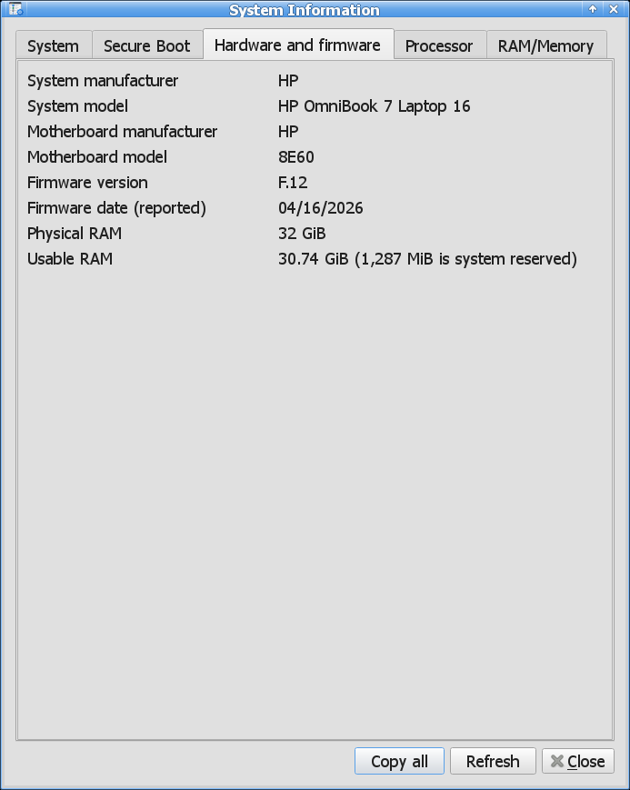
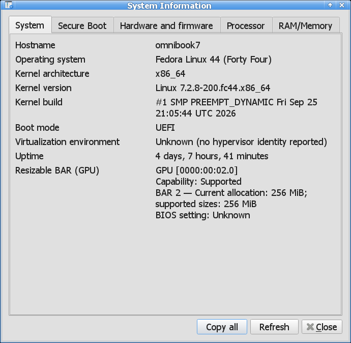
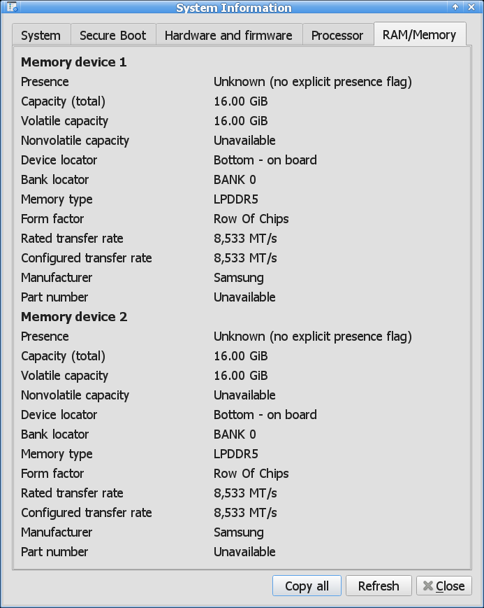
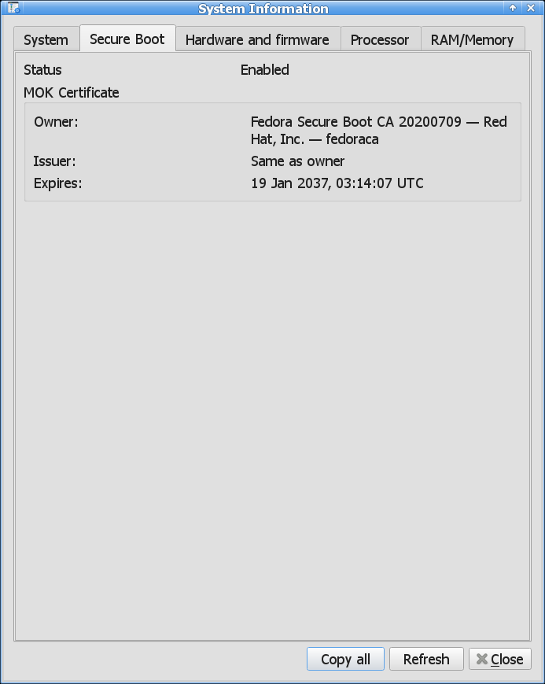

# Screenshots

QLinuxDeviceManages, a Windows Device Manager alternative for Linux that also works as a System Information Viewer.

## Main Window

### Main Window Search/Filter

## Device Properties

## Monitor Information

## System Information
### Hardware and firmware

### System including Boot mode (BIOS/UEFI) and Resizable BAR status

### RAM information including OEM, speed in MT/s, standard (DDR4/DDR5/DDR6)

### Secure Boot status

